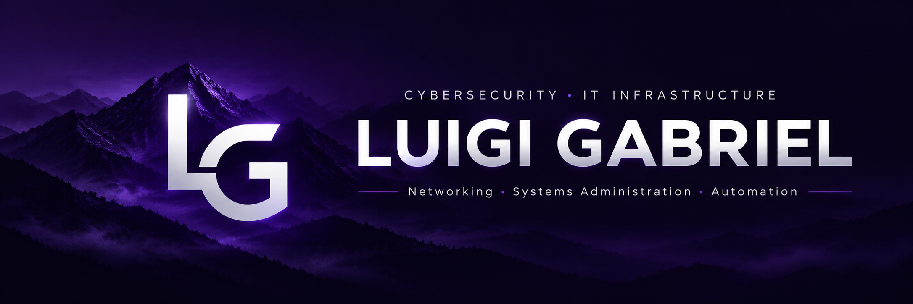

  

# Hi there, I'm Luigi Gabriel 👋

**IT Infrastructure & Support | Cybersecurity | Networking | Systems Administration | Automation**

## About Me

I'm an IT professional with experience in technical support, IT infrastructure, systems administration, and incident management. My background includes supporting corporate environments, working with Microsoft technologies, and troubleshooting infrastructure issues.

I'm expanding my knowledge of **cybersecurity**, building on my experience in infrastructure and networking through ongoing study and practical projects. This GitHub profile will document that journey, including technical labs, tools, and lessons learned.

## Technical Background

- **Infrastructure & Support:** Corporate IT environments, server and workstation support, troubleshooting, and maintenance.
- **Systems Administration:** Microsoft environments, Active Directory, SCCM, Exchange, and SharePoint.
- **Networking:** Network infrastructure support, fundamentals, and simulation with Cisco Packet Tracer.
- **IT Operations:** Incident and request management, ITSM workflows, and technical support.

## 🔭 What I'm Currently Working On

- Building and organizing this professional GitHub portfolio.
- Preparing clear, reproducible documentation for future cybersecurity and infrastructure labs.

## 🌱 What I'm Currently Learning

- **CompTIA Security+** — Studying toward the certification; not yet certified.
- **CS50 — Introduction to Computer Science** — In progress.
- **Cybersecurity** — Continuing to develop knowledge of core security concepts and practices.

## 🎓 Completed Courses & Training

- **Cisco Packet Tracer** — Networking and network simulation.
- **ISO/IEC 27001** — Information security.
- **ISO 9001** — Quality management systems.
- **ITIL** — Incident and request management.

> These are completed courses or training activities. They are not presented as official professional certifications.

## 📂 Featured Projects

Projects and hands-on labs will be linked here once they are documented and ready to share.

Areas I plan to explore include **Cybersecurity**, **Networking & Infrastructure**, **Cloud & DevOps**, and **Automation & Scripting**.

---

  Practical learning · Clear documentation · Continuous improvement

